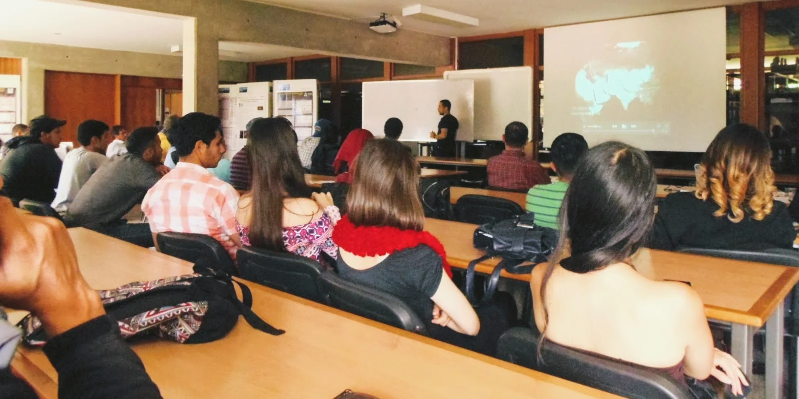
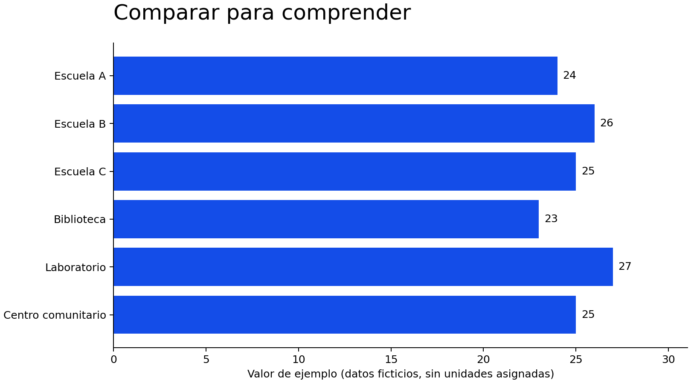
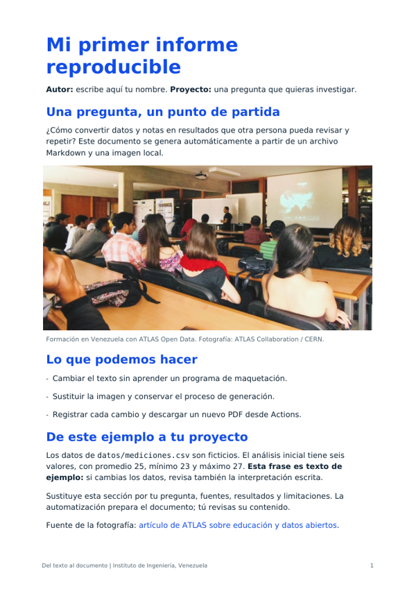

# De los datos abiertos al conocimiento compartido

[](https://github.com/artfisica/presentacion-Instituto-de-Ingenieria-Venezuela/actions/workflows/01-analizar.yml)
[](https://github.com/artfisica/presentacion-Instituto-de-Ingenieria-Venezuela/actions/workflows/02-graficar.yml)
[](https://github.com/artfisica/presentacion-Instituto-de-Ingenieria-Venezuela/actions/workflows/03-pdf.yml)
[](https://github.com/artfisica/presentacion-Instituto-de-Ingenieria-Venezuela/actions/workflows/pages.yml)
[](LICENSE)

## Empieza aquí: de 25 a 26

1. Crea tu copia con **Use this template → Create a new repository**, si el botón está disponible. Puedes usar **Fork** si prefieres mantener el vínculo con futuras actualizaciones; habilita Actions en tu fork si GitHub lo pide.
2. En `datos/mediciones.csv`, cambia el primer **24** por **30** y guarda el commit.
3. Abre **Actions → 01 - Analizar datos**. El resumen de la ejecución mostrará el promedio **26**, mínimo **23** y máximo **30**, sin descargar ningún archivo.

El repositorio incluye los tres ejercicios. Para ejecutarlos localmente empieza con `python3 scripts/analizar.py`; la instalación completa está más abajo.




**Computación, automatización e inteligencia artificial para investigar y aprender.**

Charla en línea de Arturo Sánchez Pineda para el Instituto de Ingeniería, Venezuela.

**Este mismo repositorio es tu punto de partida.** Puedes clonarlo, ejecutar los ejemplos y adaptarlos a tu tesis, clase o proyecto. Si puedes y quieres, llega a la charla con tu cuenta de GitHub creada.

[Presentación en español](https://artfisica.github.io/presentacion-Instituto-de-Ingenieria-Venezuela/) · [English](https://artfisica.github.io/presentacion-Instituto-de-Ingenieria-Venezuela/en.html) · [Guía de ejercicios](ejercicios/README.md)

## Qué vas a aprender

- Organizar datos, código, notas e imágenes para que otra persona pueda comprender y repetir tu trabajo.
- Usar Git y GitHub para conservar versiones, explicar cambios y colaborar.
- Convertir tareas repetidas en scripts: analizar datos, dibujar un gráfico y preparar un informe.
- Automatizar esas tareas para obtener nuevos resultados cuando cambien los archivos.
- Utilizar modelos de lenguaje para entender y adaptar código, manteniendo la revisión de los resultados en tus manos.

## Carpetas para empezar

| Carpeta | Qué encontrarás |
|---|---|
| `datos/` | Un CSV pequeño con datos ficticios. |
| `ejemplos/` | Un informe Markdown que puedes editar. |
| `imagenes/` | La imagen utilizada en ese informe. |
| `scripts/` | Tres programas Python: análisis, gráfico y PDF. |
| `ejercicios/` | Pasos guiados y notas para tu propio proyecto. |
| `resultados/` | Los archivos generados al ejecutar los programas. |
| `web/` | La página bilingüe de la presentación. |

Las automatizaciones están en `.github/workflows/`. Puedes empezar editando los ejemplos sin cambiar su configuración.

## Ejercicios

| Cambias… | Se ejecuta… | Obtienes… |
|---|---|---|
| `datos/mediciones.csv` | **01 - Analizar datos** | Resumen JSON e informe HTML. |
| El mismo CSV o el script del gráfico | **02 - Crear grafico** | Una imagen PNG. |
| `ejemplos/informe.md` o una imagen en `imagenes/` | **03 - Crear PDF** | Un PDF actualizado con texto e imágenes. |

También puedes ejecutar cualquiera desde **Actions → nombre del ejercicio → Run workflow**. El resumen de cada ejecución muestra los números o el número de páginas y un enlace de descarga. **Artifacts** conserva la copia completa. Se conserva durante 14 días. Estas tres acciones generan archivos descargables y no crean commits.

**[Empieza por la guía de los tres ejercicios](ejercicios/README.md).** El primer cambio consiste en sustituir un 24 por un 30 y comprobar que el promedio cambia de 25 a 26.

## Desde el navegador

Usa **Use this template** cuando esté habilitado para crear tu propio proyecto. Si deseas seguir las actualizaciones de este repositorio, utiliza **Fork**; en ese caso habilita sus flujos en **Actions** si GitHub te lo pide. Edita un dato o el Markdown y guarda el cambio: los ejercicios correspondientes se ejecutan automáticamente.

No necesitas instalar Python para esta vía. Una cuenta de GitHub te permite tener tu copia; revisa las condiciones y cuotas de los servicios que utilices. La publicación de la web está separada de los tres ejercicios y solo se activa en el repositorio de Arturo.

## Desde tu ordenador

Necesitas Git y Python 3.10 o posterior. Las acciones utilizan Python 3.12.

```bash
git clone https://github.com/artfisica/presentacion-Instituto-de-Ingenieria-Venezuela.git
cd presentacion-Instituto-de-Ingenieria-Venezuela
python3 scripts/analizar.py
```

Este primer análisis utiliza solo Python, sin paquetes adicionales. Para el gráfico y el PDF:

```bash
python3 -m venv .venv
source .venv/bin/activate
python -m pip install -r requirements.txt
python scripts/graficar.py
python scripts/crear_pdf.py
```

Abre los archivos de `resultados/`. En Windows puedes crear el entorno con `py -3 -m venv .venv` y activarlo en PowerShell con `.venv/Scripts/Activate.ps1`.

Clonar descarga el material y permite trabajar localmente. Para subir tus cambios a GitHub, utiliza tu propio fork como repositorio remoto. También puedes abrir un Codespace de tu copia y utilizar los mismos comandos en su terminal, dentro de las cuotas de tu cuenta.

## Del ejemplo a tu investigación

Sustituye los datos, formula una pregunta, adapta el script y documenta tus fuentes, unidades y decisiones en `ejercicios/NOTAS.md`. Si utilizas un modelo de lenguaje, pídele una explicación del cambio y verifica el resultado. Una automatización repetible facilita la revisión; la interpretación científica sigue siendo tu responsabilidad.

## Para Arturo

**Para aplicar solo la reducción de fuentes y correcciones pequeñas, sigue [PARCHE-FUENTES.md](PARCHE-FUENTES.md).** Las fuentes PDF incluidas ocupan 536 kB; su repertorio y procedencia están en [fuentes/README.md](fuentes/README.md).

**Para actualizar el repositorio ya publicado, sigue [ACTUALIZAR.md](ACTUALIZAR.md).** [PUBLICAR.md](PUBLICAR.md) conserva las instrucciones de la primera publicación. La página se puede revisar localmente abriendo `web/index.html`. El anuncio ampliado está en `telegram-es.md`.

Las versiones extensas están en `web/content/long-version-es.md` y `web/content/long-version-en.md`. Créditos y referencias en [SOURCES.md](SOURCES.md). Para editar la web, cambia `web/content/site.py` y ejecuta `python3 web/build.py`.

## English quick start

This same repository contains the presentation and three practical exercises: analyse a CSV, create a PNG chart and build a PDF from Markdown and local images. Clone for local use, or fork to edit and run Actions in your own account. Start with `python3 scripts/analizar.py`; install `requirements.txt` in a virtual environment for the chart and PDF. Instructions in [ejercicios/README.md](ejercicios/README.md) include an English summary. Changing the Markdown **or an image** triggers a new PDF build. Download outputs from the completed workflow's **Artifacts** section. The teaching workflows never push commits or publish a website.

## Mira lo que vas a producir



[](ejemplos/salida-esperada/informe.pdf)

[Gráfico PNG](ejemplos/salida-esperada/grafico.png) · [PDF completo](ejemplos/salida-esperada/informe.pdf) · [Resumen JSON](ejemplos/salida-esperada/resumen.json)

Estas salidas corresponden a los datos iniciales: **6 valores, promedio 25, mínimo 23 y máximo 27**. Son referencias para comparar; tus nuevas ejecuciones escriben en `resultados/` y no las sobrescriben.

## Reutilizar y citar

El **código original usa MIT**. El **texto, los datos ficticios y las imágenes originales de Arturo usan CC BY 4.0**. Las fotografías, materiales y fuentes de terceros conservan sus propias condiciones: consulta [LICENSE](LICENSE) y [THIRD_PARTY.md](THIRD_PARTY.md).

[CITATION.cff](CITATION.cff) contiene los datos de autoría y citación. **El DOI y la versión archivada aún están pendientes de publicación por Arturo**; no se inventa un DOI ni se presenta una etiqueta como publicada. La guía para activar la plantilla, conectar Zenodo y publicar `v1.0` está en [ACTUALIZAR.md](ACTUALIZAR.md).

## Otra experiencia: una tesis desde la ULA

[Oscar Alejandro Altuve Pabon: análisis de Higgs con ATLAS Open Data](https://zenodo.org/records/18372123). Licenciatura defendida en 2022, supervisada por Arturo Sánchez y Alberto Patiño. Un ejemplo de cómo combinar ROOT/C++, notebooks y un entorno local reproducible para investigar desde Venezuela. [Código de la tesis](https://github.com/AltuOs/HZZ4l/releases/tag/v2.0.0).

**English:** [Oscar’s undergraduate thesis at ULA](https://zenodo.org/records/18372123) adds a third university example alongside Iskya and María. It connects Higgs analysis with reproducible local computing.

## De Open Key a infraestructura compartida / From Open Key to shared infrastructure

- **CHEP 2018 — ATLAS Open Data y Open Key:** Arturo presentó entornos transportables en USB para formar estudiantes con conectividad limitada. [Ficha de la contribución](https://indico.cern.ch/event/587955/contributions/2938491/) · [Diapositivas](https://indico.cern.ch/event/587955/contributions/2938491/attachments/1635910/2689773/CHEP_2018_Arturo_Sanchez_ATLAS_Open_Data.pdf).
- **CHEP 2021 — despliegue multiusuario:** artículo de Arturo Sánchez Pineda y Giovanni Guerrieri sobre JupyterHub e infraestructura reproducible. [Artículo](https://cds.cern.ch/record/2772504/files/epjconf_chep2021_01008.pdf) · [DOI](https://doi.org/10.1051/epjconf/202125101008).

**English:** The 2018 contribution demonstrates portable educational resources; the 2021 paper proposes shared deployments. Both underpin this workshop’s approach: give students a working starting point they can understand, reproduce and adapt. The 2018 event page and slides describe the same contribution.
