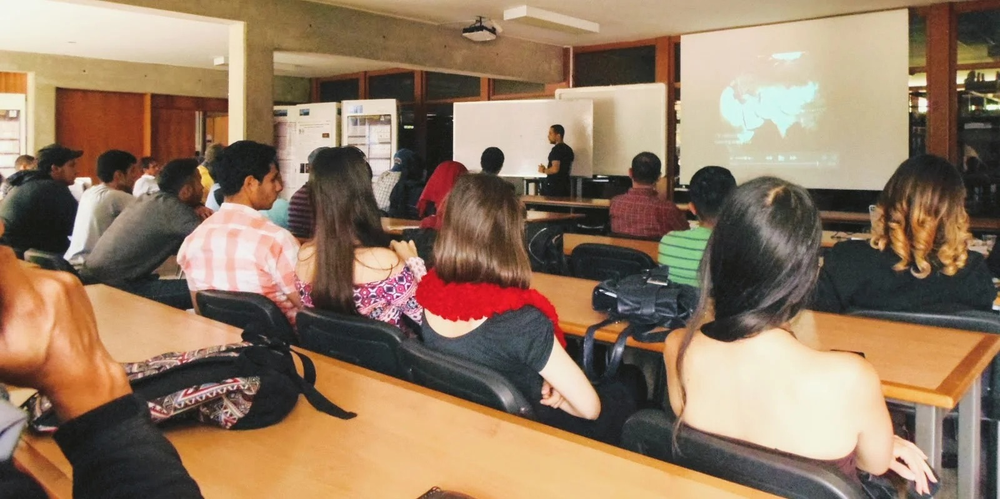

# Mi primer informe reproducible

**Autor:** escribe aquí tu nombre. **Proyecto:** una pregunta que quieras investigar.

## Una pregunta, un punto de partida

¿Cómo convertir datos y notas en resultados que otra persona pueda revisar y repetir? Este documento se genera automáticamente a partir de un archivo Markdown y una imagen local.

## Lo que podemos hacer

- Cambiar el texto sin aprender un programa de maquetación.
- Sustituir la imagen y conservar el proceso de generación.
- Registrar cada cambio y descargar un nuevo PDF desde Actions.

## De este ejemplo a tu proyecto

Los datos de `datos/mediciones.csv` son ficticios. El análisis inicial tiene seis valores, con promedio 25, mínimo 23 y máximo 27. **Esta frase es texto de ejemplo:** si cambias los datos, revisa también la interpretación escrita.

Sustituye esta sección por tu pregunta, fuentes, resultados y limitaciones. La automatización prepara el documento; tú revisas su contenido.

Fuente de la fotografía: [artículo de ATLAS sobre educación y datos abiertos](https://atlas.cern/updates/blog/HEP-education-worldwide-with-atlas-open-data).
